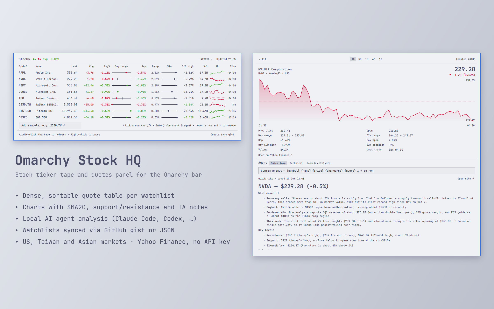

# Omarchy Stock HQ

A fork of [`5d0tal1gat0r/omarchy-stocks`](https://github.com/5d0tal1gat0r/omarchy-stocks) for Omarchy.

All original stock ticker implementation credit goes to the upstream project and its author. This fork keeps the MIT license and preserves upstream attribution.

## Features added in this fork

### Manual refresh button

<details>
<summary>force-refresh all stock data from the plugin panel header using the `⟳` refresh icon.</summary>

The stock tape still supports middle-click refresh, and the new panel `⟳` button makes the action visible and easier to discover.

</details>

## Overview

A Wall-Street-style ticker tape for the Omarchy Quattro bar. The tape scrolls
your symbols (`AAPL 305.59 ▲0.42%  •  NVDA …`) in the theme's green/red; click
it for a panel with sparklines, a detail chart with range selector, key stats,
watchlists, inline add/edit/delete, technical analysis, and a currency switch.
Quotes and FX rates come from Yahoo Finance — no API key.



## Install

```sh
omarchy plugin add https://github.com/siygle/omarchy-stock-hq.git --enable
```

The widget lands in the bar's center section. Move it with:

```sh
omarchy bar move io.github.siygle.stock-hq --section right
```

## Usage

| where | action | effect |
|-------|--------|--------|
| tape | left click | open / close the panel (Esc closes, Tab switches panels) |
| tape | middle click | refresh now |
| `⚙` panel-header button | left click | open the watchlists JSON definition file |
| `⟳` panel-header button | left click | refresh all stock data now |
| tape | right click / hover | pause the tape (hover pauses while pointing) |
| panel | `1D 5D 1M 6M 1Y` | chart range (persisted) |
| settings panel | refresh interval | change how often stock data updates automatically |
| settings panel | `Native ⇄` / currency chip | left click: next currency · right click: previous · `Native` = each quote in its own currency |
| settings panel | `Export` | open the file picker to choose an export folder; writes a dated stock-list JSON there |
| settings panel | `Import` | open the file picker to choose a stock-list JSON file to import |
| settings panel | `Open JSON` | open the active local `watchlists.json` file |
| panel | click a row | show that symbol's chart and stats |
| panel | `+ Symbol`, `Edit`, `×` | add, edit, or delete symbols directly |
| panel | watchlist chips / `+ Watchlist` | switch lists or create another list |
| panel | list name field / `Delete list` | rename or remove the active watchlist (saved to `watchlists.json`) |
| panel | `Technical analysis` | plain-English trend notes with SMA20, RSI14, support/resistance and volume context |
| panel | `Open on Yahoo Finance ↗` | open the selected symbol in your browser |

IPC (for keybindings): `omarchy-shell io.github.siygle.stock-hq toggle|open|close|refresh|pause`

## Configure

Watchlists live in a JSON definition file instead of being stored as shell.json text-field output. From the settings panel, use **Export** to choose a folder and write a dated JSON file there, or **Import** to pick a JSON file from your file manager. You can also edit the active local file directly:

```sh
$EDITOR ~/.local/share/omarchy-stock-hq/watchlists.json
omarchy-shell io.github.siygle.stock-hq refresh
```

The default file shape is:

```json
{
  "version": 1,
  "activeWatchlist": 0,
  "watchlists": [
    { "name": "Main", "symbols": ["AAPL", "NVDA", "SPCX", "GOOGL"] },
    { "name": "Taiwan", "symbols": ["2330.TW", "0050.TW"] }
  ]
}
```

UI preferences still live on the widget's entry in `~/.config/omarchy/shell.json` and apply instantly. Fetched quote/chart data is cached separately in `~/.local/state/omarchy-stock-hq/cache.json` so the widget can show the last known data immediately after an Omarchy shell restart while refreshing in the background:

```sh
omarchy bar set io.github.siygle.stock-hq tickerWidth 260
omarchy bar set io.github.siygle.stock-hq scrollSpeed 30
omarchy bar set io.github.siygle.stock-hq currency EUR
omarchy bar set io.github.siygle.stock-hq compact true --json    # "AAPL ▲0.42%" without the price
```

| key | default | meaning |
|-----|---------|---------|
| `watchlistsPath` | `~/.local/share/omarchy-stock-hq/watchlists.json` | optional full path to another watchlist definition JSON file |
| `refreshMinutes` | `5` | quote refresh interval (minimum 1) |
| `tickerWidth` | `180` | tape width in px (minimum 80) |
| `scrollSpeed` | `20` | tape speed in px/s; `0` = static |
| `compact` | `false` | drop the price from the tape |
| `chartRange` | `1d` | one of `1d 5d 1mo 6mo 1y` (the panel chips set this) |
| `currency` | `""` (native) | show every price in this currency, e.g. `EUR` (the settings panel chip sets this) |
| `currencies` | `["USD","EUR","GBP","JPY","CHF"]` | what the settings panel currency chip cycles through |
| `upColor` / `downColor` | theme `green` / `red` | override the tints with a hex color, e.g. `"#a6e3a1"` |

Unknown symbols show as `Not Found` in the panel and are left out of the tape.
Yahoo's free chart endpoint is used for Taiwan/Asia too. Native Yahoo symbols
work (`2330.TW`, `6488.TWO`, `0700.HK`, `7203.T`, `005930.KS`) and the panel
also accepts shortcuts like `TW:2330`, `TWO:6488`, `HK:0700`, `JP:7203`,
`KR:005930`, `SH:600519`, `SZ:000001`, `SG:D05`, and `AU:BHP`. Colors follow
the current theme's `colors.toml`; themes without a `green` get a neutral
fallback.

## Develop

Clone this repository (or your fork), then from its root:

```sh
node --test test/model.test.js                              # Model.js unit tests
qmllint -I /usr/share/omarchy/shell Panel.qml
omarchy plugin validate "$PWD"
omarchy plugin add "$PWD" --enable                          # installs a clone into ~/.config/omarchy/plugins/
rsync -a --delete --exclude .git ./ ~/.config/omarchy/plugins/io.github.siygle.stock-hq/
omarchy restart shell                                       # QML is cached per shell process; a restart loads the edit
qs log -p /usr/share/omarchy/shell --tail 100               # shell log
```

`Model.js` holds every piece of logic that does not need QML (parsing, formatting,
conversion, chart geometry, technical indicators/explanations) so it can be
tested with plain Node.

## Remove

```sh
omarchy plugin remove io.github.siygle.stock-hq
```

## License

MIT
