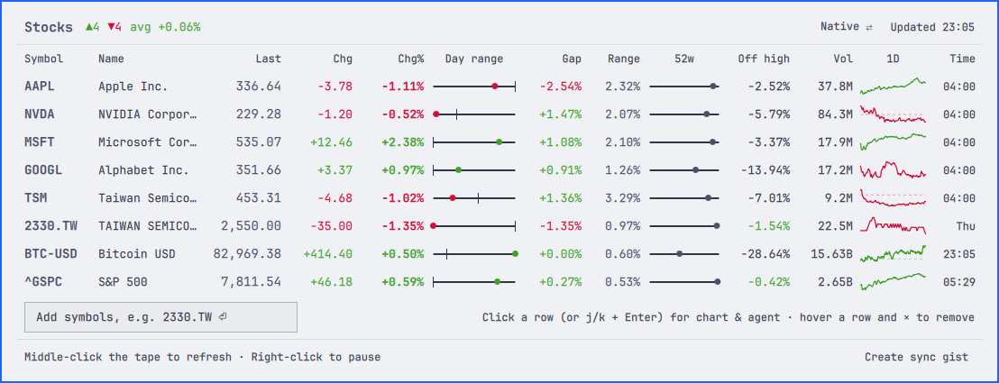
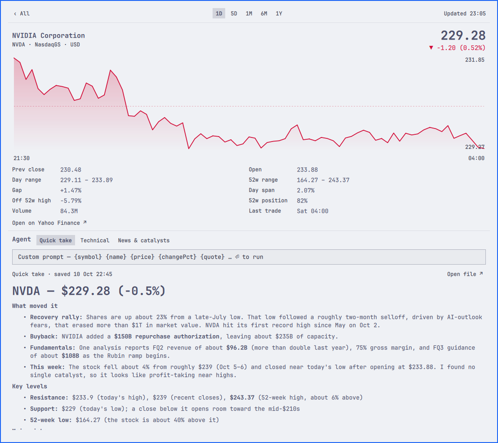

# Stock HQ for Omarchy

> Fork of [5d0tal1gat0r/omarchy-stocks](https://github.com/5d0tal1gat0r/omarchy-stocks)
> that adds a quant-dense quote table, a local AI agent per symbol and a
> gist-synced watchlist. See [Credits](#credits).

A Wall-Street-style ticker tape for the Omarchy Quattro bar. The tape scrolls
your symbols (`AAPL 305.59 ▲0.42%  •  NVDA …`) in the theme's green/red; click
it for a two-level panel:

- **Level 1** — a dense, sortable table: last, change, change %, day-range bar,
  opening gap, day span, 52-week position, distance off the 52-week high,
  volume, 1D sparkline and last trade time, plus an advancers/decliners summary.
- **Level 2** — one symbol: chart with range selector, full stats, and a local
  AI agent (Claude Code, Codex, Gemini, … ) that analyses the symbol in the
  background with preset or custom prompts.

The watchlist can sync with a GitHub gist, so you can also edit it on the web.
Quotes and FX rates come from Yahoo Finance — no API key.

**Level 1: every symbol at a glance.** Sort by any column; the bars show where
the price sits in the day's range (tick = previous close) and in its 52-week range.



**Level 2: one symbol, with the agent's answer.** Chart, full stats, and a
Quick take written by Claude Code with web search, rendered in the panel.



## Install

```sh
omarchy plugin add https://github.com/siygle/omarchy-stock-hq.git --enable
```

The plugin id is `io.github.siygle.stock-hq`, so it installs next to the
upstream `io.github.5d0tal1gat0r.stocks` widget instead of replacing it. If you
are switching over, copy your settings (`symbols`, `currency`, …) across with
`omarchy bar set` and remove the upstream plugin. Optional requirements: the
[`gh`](https://cli.github.com) CLI, signed in, for gist sync, and an agent CLI
(`claude`, `codex`, `gemini`, …) for analysis.

The widget lands in the bar's center section. Move it with:

```sh
omarchy bar move io.github.siygle.stock-hq --section right
```

## Usage

| where | action | effect |
|-------|--------|--------|
| tape | left click | open / close the panel (Esc closes, Tab switches panels) |
| tape | middle click | refresh now |
| tape | right click / hover | pause the tape (hover pauses while pointing) |
| table | click a row / `j` `k` + Enter | open that symbol (level 2); Esc or `h` goes back |
| table | click a column header | sort descending → ascending → watchlist order (persisted) |
| table | `Add symbols` field | add one or more symbols (`tsm, 2330.TW`) |
| table | hover a row, `×` | remove the symbol |
| table | `USD ⇄` chip | left click: next currency · right click: previous · `Native` = each quote in its own currency |
| table | `Create sync gist` / `Sync` / `Open gist ↗` | see [Gist sync](#gist-sync) |
| detail | `1D 5D 1M 6M 1Y` | chart range (persisted) |
| detail | agent preset chips / custom prompt field | run the agent on this symbol, see [Agent](#agent) |
| detail | `Open on Yahoo Finance ↗` | open the symbol in your browser |

IPC (for keybindings): `omarchy-shell io.github.siygle.stock-hq toggle|open|close|refresh|pause|sync`,
`… detail <SYMBOL>` (open level 2) and `… analyze <SYMBOL>` (open level 2 and run the first agent preset).

## Gist sync

Click `Create sync gist` in the panel footer: a secret gist holding
`stocks.json` is created with your current list and its id is stored as
`gistId`. Or point at an existing gist:

```sh
omarchy bar set io.github.siygle.stock-hq gistId https://gist.github.com/<you>/<id>
```

Every refresh pulls the gist; an edit made on gist.github.com replaces the
local list, and adding/removing symbols in the panel pushes straight back. The
gist wins when both sides changed (and on shell start). The file may be
`{"symbols": [...]}`, a JSON array, or plain text — one symbol per line or
comma separated, `#` for comments. All calls go through the signed-in `gh` CLI
(`gh auth login`); no token is stored by the widget.

## Agent

Level 2 runs a local agent CLI in the background on the shown symbol, streams
its answer into the panel (rendered as Markdown), and keeps the latest answer
per symbol in `~/.cache/omarchy-stocks/agent/<SYMBOL>.md`. One run at a time;
`Cancel` stops it.

```sh
# the default; any CLI that takes a prompt argument and prints the answer works
omarchy bar set io.github.siygle.stock-hq agentCommand '["claude","-p","--allowedTools=WebSearch,WebFetch","{prompt}"]' --json
omarchy bar set io.github.siygle.stock-hq agentCommand '["codex","exec","{prompt}"]' --json
omarchy bar set io.github.siygle.stock-hq agentPrompts '[{"name":"繁中快評","prompt":"用繁體中文分析 {name} ({symbol})，最新報價：{quote}"}]' --json
```

Every prompt is sent with the symbol on screen as context: a line naming it
and its latest quote as JSON is prepended, so a bare custom prompt like
`這支股票近期的風險？` works. Prompts that already use `{quote}` (such as the
Quick take preset) carry the data themselves and are sent as written.

Prompts (presets and the custom field) can also use `{symbol} {name} {exchange}
{currency} {price} {change} {changePct} {dayLow} {dayHigh} {week52Low}
{week52High} {volume}` and `{quote}` (all quote fields as JSON).

## Configure

Settings live on the widget's entry in `~/.config/omarchy/shell.json` and apply
instantly:

```sh
omarchy bar set io.github.siygle.stock-hq symbols '["AAPL","MSFT","BTC-USD","^GSPC"]' --json
omarchy bar set io.github.siygle.stock-hq tickerWidth 260
omarchy bar set io.github.siygle.stock-hq scrollSpeed 30
omarchy bar set io.github.siygle.stock-hq currency EUR
omarchy bar set io.github.siygle.stock-hq compact true --json    # "AAPL ▲0.42%" without the price
```

| key | default | meaning |
|-----|---------|---------|
| `symbols` | `["AAPL","NVDA","SPCX","GOOGL"]` | any Yahoo Finance symbols (stocks, ETFs, `BTC-USD`, `EURUSD=X`, `^GSPC`); a comma-separated string also works |
| `refreshMinutes` | `5` | quote refresh interval (minimum 1) |
| `tickerWidth` | `180` | tape width in px (minimum 80) |
| `scrollSpeed` | `20` | tape speed in px/s; `0` = static |
| `compact` | `false` | drop the price from the tape |
| `chartRange` | `1d` | one of `1d 5d 1mo 6mo 1y` (the panel chips set this) |
| `currency` | `""` (native) | show every price in this currency, e.g. `EUR` (the panel chip sets this) |
| `currencies` | `["USD","EUR","GBP","JPY","CHF"]` | what the currency chip cycles through |
| `upColor` / `downColor` | theme `green` / `red` | override the tints with a hex color, e.g. `"#a6e3a1"` |
| `sortKey` / `sortDesc` | `""` / `true` | table sort (the column headers set these); `""` = watchlist order |
| `gistId` | `""` (off) | gist id or URL for watchlist sync |
| `gistFile` | `stocks.json` | file inside the gist |
| `agentCommand` | `["claude","-p","--allowedTools=WebSearch,WebFetch","{prompt}"]` | agent argv; `{prompt}` is replaced (appended when absent) |
| `agentPrompts` | Quick take / Technical / News & catalysts | `[{"name": …, "prompt": …}]` preset chips |

Unknown symbols show as `Not Found` in the panel and are left out of the tape.
Colors follow the current theme's `colors.toml`; themes without a `green` get a
neutral fallback.

## Develop

Clone this repository (or your fork), then from its root:

```sh
node --test test/model.test.js                              # Model.js unit tests
/usr/lib/qt6/bin/qmllint -I /usr/share/omarchy/shell *.qml
omarchy plugin validate "$PWD"
omarchy plugin add "$PWD" --enable                          # installs a clone into ~/.config/omarchy/plugins/
rsync -a --delete --exclude .git ./ ~/.config/omarchy/plugins/io.github.siygle.stock-hq/
omarchy restart shell                                       # QML is cached per shell process; a restart loads the edit
qs log -p /usr/share/omarchy/shell --tail 100               # shell log
```

`Model.js` holds every piece of logic that does not need QML (parsing, formatting,
conversion, chart geometry, table metrics, gist and agent commands) so it can be
tested with plain Node. `Panel.qml` owns the state; `QuoteTable.qml` (level 1)
and `DetailView.qml` (level 2) render it; `GistSync.qml` and `AgentRunner.qml`
wrap the `gh` and agent processes.

## Remove

```sh
omarchy plugin remove io.github.siygle.stock-hq
```

## Credits

Built on [omarchy-stocks](https://github.com/5d0tal1gat0r/omarchy-stocks) by
[@5d0tal1gat0r](https://github.com/5d0tal1gat0r). This fork reuses its whole
foundation: the ticker tape, the Yahoo Finance fetching and parsing, currency
conversion, chart geometry, theming and the test suite. Thank you! This fork
adds the level-1 quote table, the level-2 view with the local agent runner,
and gist sync.

## License

MIT. See [LICENSE](LICENSE); the original copyright notice of
omarchy-stocks is kept.
