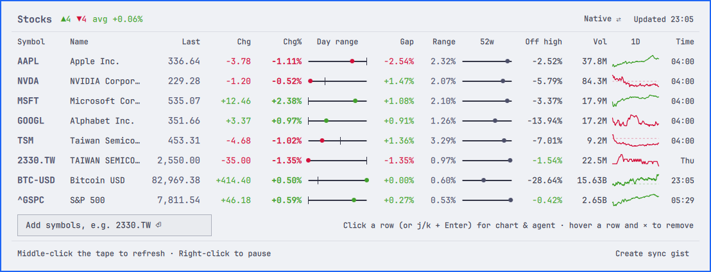
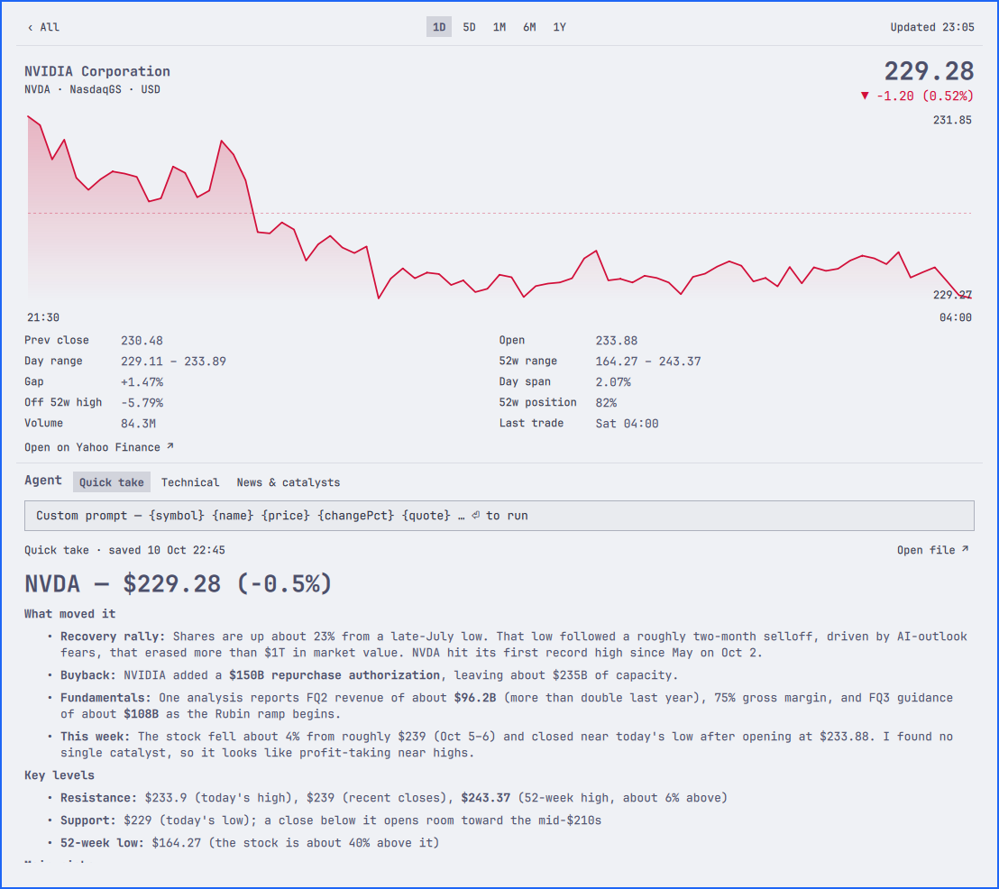
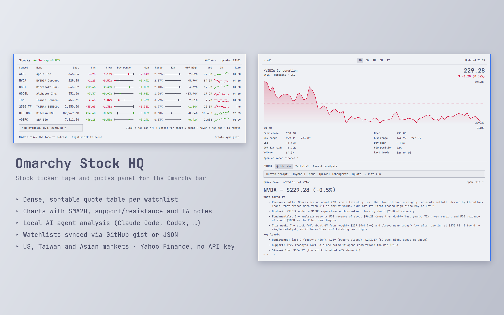

# Omarchy Stock HQ

> 由 [5d0tal1gat0r/omarchy-stocks](https://github.com/5d0tal1gat0r/omarchy-stocks) fork 而來。跑馬燈的原始實作歸功於上游作者，見 [致謝](#致謝)。

**Omarchy 工作列上的看盤外掛**：跑馬燈、自選股報價表、個股快覽。不裝別的程式也能完整使用。

目前版本見 [manifest.json](manifest.json)（`0.3.1`）。下面的圖是 2026-10 留下的畫面，標題還是當時的「Stocks」（現在是「Stock HQ」），也還沒有後來加上的清單列、`⚙` / `⟳`，以及「在 App 開啟」。

## 用途

- **工作列跑馬燈**：自選股依主題配色紅綠捲動，例如 `AAPL 305.59 ▲0.42%`。`compact` 打開時不顯示價格。
- **報價總表**（點跑馬燈開啟）：多個自選清單。欄位可排序，包含漲跌、日區間、52 週位置、成交量、1D 走勢小圖。
- **個股快覽**：區間圖（SMA20、近期支撐／壓力）、技術面白話（趨勢、SMA20/50、RSI14、成交量）、完整數據，以及用你電腦上的 AI 工具產生快評。
- 支援台股與其他亞洲市場（`2330.TW` 或 `TW:2330`）。報價與匯率來自 Yahoo Finance，**免 API 金鑰**，並會快取，重開 shell 後先顯示上次資料。
- 自選股存在 JSON 檔，可匯入／匯出，也能用 GitHub gist 同步。



*報價總表，提交於 2026-10-10。點欄位標題可排序。圖中還沒有清單 chips、`⚙`、`⟳`。*



*個股快覽，同一天的畫面；快評標示 saved 10 Oct 22:45。有 `1D`–`1Y`、Yahoo Finance 連結與 Agent 區塊，還沒有「在 App 開啟 ↗ (o)」。*



*2026-10-11 用上面兩張畫面拼成的介紹圖，不是工作列跑馬燈。*

想對單一檔股票做更深入的研究（完整 K 線、技術指標、可追問並存檔的 AI 報告），可以另外裝選配的 [stock-hq-app](https://github.com/siygle/stock-hq-app)，見 [搭配 stock-hq-app（選配）](#搭配-stock-hq-app選配)。不裝也不影響這個外掛。

## 安裝

```sh
omarchy plugin add https://github.com/siygle/omarchy-stock-hq.git --enable
```

外掛 id 是 `io.github.siygle.stock-hq`，會和上游 `io.github.5d0tal1gat0r.stocks` 並存，不會覆蓋。從上游換過來時，用 `omarchy bar set` 把上游的 `symbols` 抄過來，會在清單檔還不存在時成為第一個清單，之後再移除上游外掛。

選配：

- 已登入的 [`gh`](https://cli.github.com) CLI：gist 同步
- AI 命令列工具（`claude`、`codex`、`gemini`…）：AI 快評

外掛預設在工作列中間。移到右邊：

```sh
omarchy bar move io.github.siygle.stock-hq --section right
```

## 第一次使用

1. 安裝後工作列出現跑馬燈。清單檔還不存在時，預設清單名是 `Main`，代號是 `AAPL`、`NVDA`、`SPCX`、`GOOGL`。
2. **左鍵點跑馬燈**打開面板。`Esc` 關閉，`Tab` 切換面板。
3. 在 `Add symbols` 輸入代號，可一次多個，例如 `tsm, TW:2330`，Enter 加入。
4. 點一列，或 `j` / `k` 移到該列再 Enter，打開個股快覽。`Esc` 或 `h` 回到總表。

查無代號時，該列名稱會顯示 `Not Found`，跑馬燈不會帶上它。

## 常用操作

介面上的按鈕文字是英文，下表沿用畫面上的寫法。

| 位置 | 操作 | 效果 |
|---|---|---|
| 跑馬燈 | 左鍵 | 開／關面板 |
| 跑馬燈 | 中鍵 | 立即更新 |
| 跑馬燈 | 右鍵 | 暫停或繼續捲動 |
| 跑馬燈 | 滑鼠停留 | 停留期間暫停捲動 |
| 總表 | 點一列，或 `j` / `k` 再 Enter | 打開個股快覽 |
| 總表 | 點欄位標題 | 排序。多數欄位是遞減 → 遞增 → 清單原順序；`Symbol` 先遞增。目前排序的標題會標出來，並記住 |
| 總表 | 右鍵欄位標題 | 回到清單原順序 |
| 總表 | 清單 chips / `+ List` | 切換或新增清單。清單很多時可用滾輪或兩側的 `‹` `›` |
| 總表 | 清單名稱欄按 Enter | 為目前清單改名 |
| 總表 | `Delete list` | 刪除目前清單。只剩一個清單時不會出現 |
| 總表 | 滑過一列，`✎` / `×` | 改寫或移除代號 |
| 總表 | `USD ⇄`（或 `Native ⇄`） | 左鍵下一個幣別，右鍵上一個。`Native` 表示各用原幣別 |
| 總表 | `⟳` | 立即更新報價 |
| 總表 | `⚙` | 更新間隔，以及清單檔的 `Export` / `Import` / `Open JSON ↗` |
| 總表 | `Create sync gist` / `Sync` / `Open gist ↗` | 見 [Gist 同步](#gist-同步) |
| 快覽 | `1D` `5D` `1M` `6M` `1Y` | 圖表區間（會記住）。技術面說明跟著這個區間 |
| 快覽 | AI 預設 chips 或自訂提問 | 對這檔跑 AI 快評。一次只跑一檔，`Cancel` 可中止 |
| 快覽 | `Open on Yahoo Finance ↗` | 用瀏覽器打開 |
| 總表 / 快覽 | `o` 或「在 App 開啟 ↗ (o)」 | **只有裝了 stock-hq-app，而且沒關掉這個連結時才看得到**。沒裝就沒有這個連結，按 `o` 也沒有反應 |

可輸入的亞洲市場簡寫會轉成 Yahoo 代號，例如 `TW:2330` → `2330.TW`、`tw2330` → `2330.TW`、`TWO:6488` → `6488.TWO`、`HK:0700` → `0700.HK`、`JP:7203` → `7203.T`、`KR:005930` → `005930.KS`、`SH:600519` → `600519.SS`、`SZ:000001` → `000001.SZ`、`SG:D05` → `D05.SI`、`AU:BHP` → `BHP.AX`。直接寫 Yahoo 代號（`2330.TW`、`6488.TWO`、`0700.HK`、`7203.T`、`005930.KS`）也可以。

## 搭配 stock-hq-app（選配）

[stock-hq-app](https://github.com/siygle/stock-hq-app) 是另一個桌面程式，用來研究單一檔股票。這個外掛才是主體：它管清單和快速瀏覽。App 不管理自選股。

| | 本外掛（主體） | stock-hq-app（選配） |
|---|---|---|
| 角色 | 清單與快速瀏覽 | 單一檔深入研究 |
| 自選股 | 多清單、gist 同步 | 不讀寫本外掛的清單 |
| 看盤 | 跑馬燈、報價總表、快覽 | 完整 K 線（平移縮放）、技術指標、KEY STATS |
| AI | 快覽裡的快評 | 串流研究報告、可追問、自動存檔 |

- **沒裝 App**：外掛自己運作。不會出現「在 App 開啟 ↗ (o)」，按 `o` 沒有動作，也**不會提示缺少 App**。
- **裝了 App**：每次打開面板會再偵測一次（`openInApp` 沒關掉時）。總表把游標放在一列上，或正在看快覽時，可按 `o`；快覽會出現「在 App 開啟 ↗ (o)」。點下去之後，外掛關掉自己的面板，並請 App 打開該代號。
- 偵測方式：`PATH` 上的 `stock-hq-app`，或可執行的 `~/.local/bin/stock-hq-app`。兩者都沒有時，若已註冊 `x-scheme-handler/stockhq`，則改走 `xdg-open stockhq://symbol/<代號>`。有執行檔時用的是 `stock-hq-app open <代號>`。
- 交給 App 之前會先正規化代號，所以 `TW:2330` 打開的是 `2330.TW`。
- App 沿用本外掛的 `agentCommand` 與 Omarchy 主題，不讀寫 `watchlists.json`。
- 不想顯示連結：`omarchy bar set io.github.siygle.stock-hq openInApp false --json`

## 進階設定

介面選項寫在 `~/.config/omarchy/shell.json` 裡這個外掛的項目，改完即時生效。自選清單不在這個檔裡。抓回來的報價與圖表快取在 `~/.local/state/omarchy-stock-hq/cache.json`。

清單檔、快取、匯出檔與 AI 答案都只有擁有者可讀：檔案 `0600`、資料夾 `0700`。舊版留下的較寬權限會在啟動時收緊。

### 自選清單檔

```sh
$EDITOR ~/.local/share/omarchy-stock-hq/watchlists.json
```

存檔後面板會重新讀取。`⚙` → `Export` 把一份日期檔寫到你選的資料夾，`Import` 讀回一份。

```json
{
  "version": 1,
  "activeWatchlist": 0,
  "watchlists": [
    { "name": "Main", "symbols": ["AAPL", "NVDA", "SPCX", "GOOGL"] },
    { "name": "Taiwan", "symbols": ["2330.TW", "0050.TW"] }
  ]
}
```

檔案還不存在時，才用設定裡的 `watchlists` 或 `symbols` 建立它。

### Gist 同步

點面板底部的 `Create sync gist`，會建立一個私密 gist（檔名預設 `stocks.json`）並記下 id。也可以指定既有 gist：

```sh
omarchy bar set io.github.siygle.stock-hq gistId https://gist.github.com/<you>/<id>
```

每次更新都會先拉 gist。你在 gist.github.com 上的修改會取代本機清單；在面板裡改清單（或匯入）會推回去。兩邊都改過時，以 gist 為準。目前選中哪一個清單不放進 gist，各台電腦各自記住。

gist 裡可以是和 `watchlists.json` 相同的多清單 JSON，也可以是 `{"symbols": [...]}`、JSON 陣列，或純文字（一行一個代號，或用逗號分隔，`#` 後面是註解）。後面這幾種會變成單一清單 `Main`。

全部透過已登入的 `gh`（`gh auth login`）。外掛不保存 token，gist 內容從 stdin 送給 `gh`，不放在命令列上。

### AI 快評

快覽在背景執行你設定的 AI 命令列工具，把輸出串流顯示成 Markdown。每檔保留最新一份成功的答案，預設路徑是 `~/.cache/omarchy-stocks/agent/<代號>.md`（若設定了 `XDG_CACHE_HOME`，則改放在那下面的 `omarchy-stocks/agent/`）。

提問從 stdin 傳給工具，不放在命令列參數上（其他本機使用者看得到 `ps` 的參數）。舊設定裡單獨的 `"{prompt}"` 參數會被忽略；只有嵌在更大參數裡的 `{prompt}`（例如 `"--prompt={prompt}"`）才會代進參數。

```sh
# 預設。任何「從 stdin 讀提問、把答案印到 stdout」的工具都可以
omarchy bar set io.github.siygle.stock-hq agentCommand '["claude","-p","--allowedTools=WebSearch,WebFetch"]' --json
# 改用 codex
omarchy bar set io.github.siygle.stock-hq agentCommand '["codex","exec"]' --json
# 自訂預設提問
omarchy bar set io.github.siygle.stock-hq agentPrompts '[{"name":"繁中快評","prompt":"用繁體中文分析 {name} ({symbol})，最新報價：{quote}"}]' --json
```

提問可用 `{symbol}` `{name}` `{exchange}` `{currency}` `{price}` `{change}` `{changePct}` `{dayLow}` `{dayHigh}` `{week52Low}` `{week52High}` `{volume}`，以及 `{quote}`（報價欄位加上目前圖表區間的技術面說明，組成 JSON）。

已經寫了 `{quote}` 的提問會照填完的原文送出。沒寫的（例如直接打「這支股票近期的風險？」）會自動在前面加上目前代號與最新報價，所以仍然知道在問哪一檔。

### 其他設定

```sh
omarchy bar set io.github.siygle.stock-hq tickerWidth 260
omarchy bar set io.github.siygle.stock-hq scrollSpeed 30
omarchy bar set io.github.siygle.stock-hq currency EUR
omarchy bar set io.github.siygle.stock-hq compact true --json
```

| 設定 | 預設 | 說明 |
|---|---|---|
| `watchlistsPath` | `~/.local/share/omarchy-stock-hq/watchlists.json` | 自選清單檔 |
| `symbols` / `watchlists` | `["AAPL","NVDA","SPCX","GOOGL"]` | 只在清單檔還不存在時用來建立 |
| `refreshMinutes` | `5` | 更新間隔，最少 1。`⚙` 裡也可以改 |
| `tickerWidth` | `180` | 跑馬燈寬度（px），最少 80 |
| `scrollSpeed` | `20` | 捲動速度（px/s）。`0` 表示不捲動 |
| `compact` | `false` | 跑馬燈不顯示價格，例如 `AAPL ▲0.42%` |
| `chartRange` | `1d` | `1d` `5d` `1mo` `6mo` `1y`，對應面板上的 `1D` `5D` `1M` `6M` `1Y` |
| `currency` | `""`（原幣別） | 全部換算成這個幣別，例如 `EUR` |
| `currencies` | `["USD","EUR","GBP","JPY","CHF"]` | 幣別 chip 循環的清單 |
| `upColor` / `downColor` | 主題的 green / red | 十六進位色，例如 `"#a6e3a1"`。主題沒有 green 時漲用 `#5fbf6f`，沒有 red 時跌用工作列的 urgent 色 |
| `sortKey` / `sortDesc` | `""` / `true` | 表格排序。`""` 表示清單原順序 |
| `gistId` | `""`（關） | gist id 或 URL |
| `gistFile` | `stocks.json` | gist 裡的檔名 |
| `agentCommand` | `["claude","-p","--allowedTools=WebSearch,WebFetch"]` | AI 工具的參數；提問走 stdin |
| `agentPrompts` | Quick take / Technical / News & catalysts | `[{"name": …, "prompt": …}]` |
| `openInApp` | `true` | 裝了 stock-hq-app 時要不要顯示連結 |

### 給快捷鍵用的指令

```sh
omarchy-shell io.github.siygle.stock-hq toggle
omarchy-shell io.github.siygle.stock-hq open
omarchy-shell io.github.siygle.stock-hq close
omarchy-shell io.github.siygle.stock-hq refresh
omarchy-shell io.github.siygle.stock-hq pause
omarchy-shell io.github.siygle.stock-hq sync
omarchy-shell io.github.siygle.stock-hq detail AAPL
omarchy-shell io.github.siygle.stock-hq analyze AAPL
```

`detail` 打開該代號的快覽。`analyze` 同樣打開，並跑第一個 AI 預設提問。`pause` 是暫停／繼續，和右鍵一樣。

## 常見問題

**需要 API 金鑰嗎？** 不需要。報價與匯率來自 Yahoo Finance。

**一定要裝 stock-hq-app 嗎？** 不用。外掛本身就是完整的看盤工具。

**AI 快評沒反應？** 先在終端機確認 `claude`（或你設的工具）能直接執行，再用 `agentCommand` 換成你有的工具。

**我的資料誰讀得到？** 自選清單、快取、匯出檔與 AI 答案都是擁有者專用（檔案 `0600`、資料夾 `0700`）。

**顏色怎麼來？** 跟隨目前主題的 `colors.toml`。可用 `upColor` / `downColor` 自訂。

**怎麼移除？**

```sh
omarchy plugin remove io.github.siygle.stock-hq
```

## 開發

在這個儲存庫的根目錄：

```sh
node --test test/model.test.js
/usr/lib/qt6/bin/qmllint -I /usr/share/omarchy/shell *.qml
omarchy plugin validate "$PWD"
omarchy plugin add "$PWD" --enable
rsync -a --delete --exclude .git ./ ~/.config/omarchy/plugins/io.github.siygle.stock-hq/
omarchy restart shell
qs log -p /usr/share/omarchy/shell --tail 100
```

`omarchy plugin add "$PWD"` 會把一份複本裝進 `~/.config/omarchy/plugins/`。QML 依 shell 行程快取，改完要重啟 shell 才會載入。

`Model.js` 放所有不需要 QML 的邏輯（解析、格式化、匯率、圖表幾何、清單、技術指標、表格、gist 與 agent 指令），可以用 Node 直接測。`Panel.qml` 管狀態，`QuoteTable.qml` 是總表，`DetailView.qml` 是快覽，`GistSync.qml` 與 `AgentRunner.qml` 分別包 `gh` 與 AI 行程。

## 致謝

建立在 [@5d0tal1gat0r](https://github.com/5d0tal1gat0r) 的 [omarchy-stocks](https://github.com/5d0tal1gat0r/omarchy-stocks) 之上。跑馬燈、Yahoo Finance 的抓取與解析、匯率換算、圖表幾何、主題配色與測試都沿用自上游，謝謝。這個 fork 加上多清單與匯入／匯出、亞洲市場代號、報價快取、技術分析、報價總表、AI 快覽、gist 同步，以及只有裝了 stock-hq-app 才出現的開啟連結。

## 授權

MIT，見 [LICENSE](LICENSE)。保留 omarchy-stocks 的原始版權聲明（Copyright (c) 2026 5d0tal1gat0r）。
